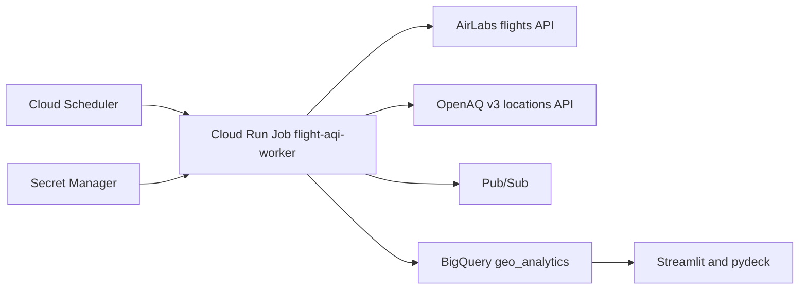
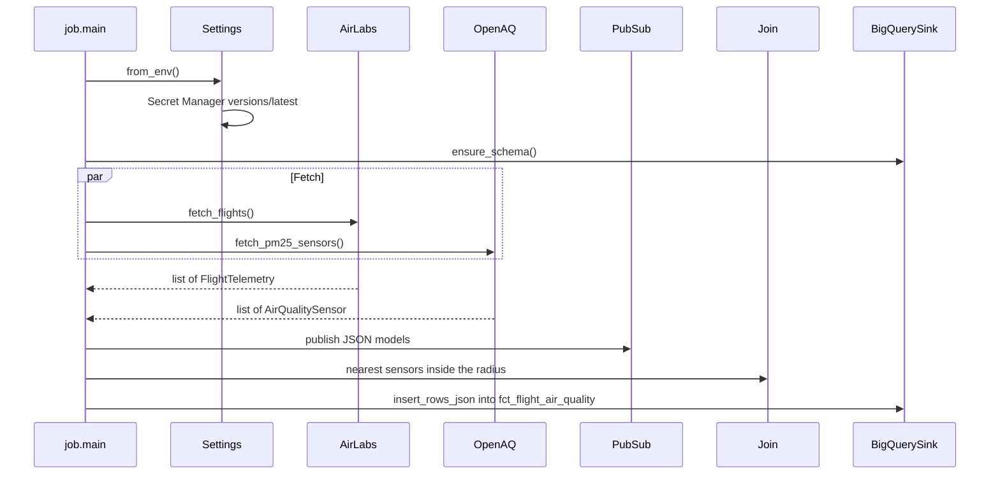

# Flight and air-quality spatial join

Hourly pipeline that polls AirLabs and OpenAQ, validates the payloads, publishes them to Pub/Sub, loads nearby matches into BigQuery, and maps the result in Streamlit.

The project covers arrivals at Pune Airport (IATA `PNQ`, ICAO `VAPO`). AirLabs is queried with `arr_iata=PNQ` inside `18.30,73.60,18.90,74.20`. OpenAQ is centered on the airport at 18.5822, 73.9197 with a 40 km radius. The stored flight number is the IATA code, such as `AI685`, built from `flight_iata` or from `airline_iata` plus `flight_number`.

## High-level architecture

Cloud Scheduler starts the Cloud Run Job `flight-aqi-worker` once an hour. The job is a single Python process. It reads API keys from Secret Manager, fetches flights and PM2.5 stations in parallel, validates them with Pydantic, publishes each record to Pub/Sub, and appends spatial matches to BigQuery. Streamlit reads one view and draws the pairs with pydeck.



| Stage | Component | Responsibility |
| --- | --- | --- |
| Trigger | Cloud Scheduler | Starts `flight-aqi-worker` every hour |
| Compute | Cloud Run Job | One-shot poll, validate, join, and load |
| Secrets | Secret Manager | `OPENAQ_API_KEY` and `AIRLABS_API_KEY`, version `latest` |
| Sources | AirLabs and OpenAQ | Live flights and PM2.5 stations |
| Broker | Pub/Sub | `flights-stream` and `air-quality-stream` |
| Sink | BigQuery `geo_analytics` | Joined flight and station rows |
| Presentation | Streamlit | Map, filters, and table for the last 7 days |

Terraform in `infra/terraform` creates the Pub/Sub topics and the `geo_analytics` dataset. Table and view DDL lives in `infra/schema.sql`. The job applies that file when the objects are missing.

## Low-level architecture

The installable package is `src/flight_aqi_spatial_join`. The console script `flight-aqi-job` calls `job.main`. The dashboard is `src/dashboard/app.py` and is not part of the job image's command.



### Ingestion

`Settings.from_env` loads `OPENAQ_API_KEY` and `AIRLABS_API_KEY` from Secret Manager in `PROJECT_ID` (default `flight-aqi-spatial-join`). If Secret Manager cannot be reached, it uses environment variables of the same names. Pub/Sub and BigQuery use Application Default Credentials.

`AirLabsClient` calls `https://airlabs.co/api/v9/flights` with `httpx2`, `arr_iata` set to `PNQ`, and the Pune bounding box. It retries on HTTP errors and HTTP 429, drops any row whose `arr_iata` is not `PNQ`, and maps the rest through `FlightTelemetry.from_airlabs`. Records without `hex`, `lat`, or `lng` are dropped. `flight_code` stores `flight_iata` when AirLabs sends it, and otherwise joins `airline_iata` with the numeric `flight_number`. `OpenAQClient` calls `https://api.openaq.org/v3/locations` with `parameters_id=2` (PM2.5) and `coordinates` as `latitude,longitude` at Pune Airport. `AirQualitySensor.from_openaq_location` keeps sensors whose parameter name is `pm25`.

`job.run_once` fetches both sources with `asyncio.TaskGroup`, then publishes, then joins.

### Messages and the spatial join

`PubSubPublisher` sends one JSON message per model. Flights go to `flights-stream` with attribute `record_type=flight`. Sensors go to `air-quality-stream` with `record_type=air_quality`.

`join_flights_to_sensors` uses the haversine helper in `packages/geo_spatial_joiner`. Each flight keeps up to `MAX_SENSORS_PER_FLIGHT` sensors inside `JOIN_RADIUS_METERS` (defaults: 3 sensors, 15 km). A match row stores the observation time, `icao24`, callsign, WKT `POINT(lng lat)` for the flight and the sensor, PM2.5, and distance in meters.

`BigQuerySink.write` appends those rows with `insert_rows_json` to `geo_analytics.fct_flight_air_quality`. That table is partitioned by `DATE(timestamp)` and clustered by `icao24, sensor_id`.

### What the dashboard reads

`src/dashboard/app.py` queries `geo_analytics.v_flight_aqi_spatial_join` for the last 7 days, up to 1,000 rows. The view unions two sources into one column set (`flight_number`, `flight_lat`, `flight_lng`, `station_id`, `station_lat`, `station_lng`, `pm25`, `distance_to_station_meters`):

- `flight_station_matches` holds the backfilled matches from the earlier raw snapshots.
- `fct_flight_air_quality` holds rows written by the hourly job. Geography columns are turned into latitude and longitude with `ST_Y` and `ST_X`.

pydeck draws a line from each flight to its station, plus a point for each. The page refreshes every 60 seconds. BigQuery credentials come from a Streamlit service-account secret when one is configured, and otherwise from Application Default Credentials.

## Deployment

The dashboard is deployed on Streamlit Community Cloud at [https://flight-aqi-spatial-join.streamlit.app/](https://flight-aqi-spatial-join.streamlit.app/). It runs `src/dashboard/app.py` and reads `geo_analytics.v_flight_aqi_spatial_join`. When a `gcp_service_account` secret is configured in Streamlit, the app uses that credential. Otherwise it uses Application Default Credentials.

## Local setup

Python 3.12 and [uv](https://docs.astral.sh/uv/) are required.

```bash
uv sync --all-groups
uv run flight-aqi-job
uv run streamlit run src/dashboard/app.py
```

`build.sh` is only for a local Docker build and one-shot run. It reads the same Secret Manager secrets into the process environment. It does not print those values and it does not deploy Cloud Run or Cloud Scheduler.
